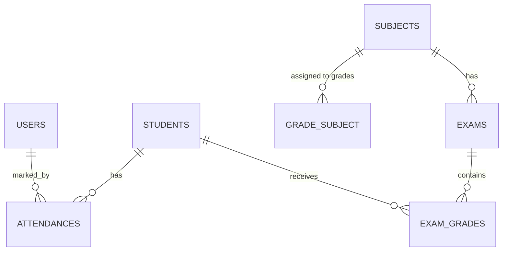

# Application Architecture

StudentHub is a conventional Laravel MVC application. There are no custom service classes, no repository layer, no API resources, and no queued jobs — controllers query Eloquent models directly and return Blade views.

## Request pipeline

```
HTTP Request
    │
    ▼
public/index.php ──► bootstrap/app.php (Application::configure)
    │                  ├── withRouting: routes/web.php, routes/console.php, health /up
    │                  ├── withMiddleware: alias 'admin' → AdminMiddleware
    │                  └── withExceptions: JSON errors for api/* or expectsJson
    ▼
Route matching (routes/web.php + routes/auth.php)
    │
    ▼
Middleware stack
    ├── 'guest'      — auth routes only (redirects logged-in users away)
    ├── 'auth'       — everything under the authenticated group
    ├── 'admin'      — /admin/* group (alias for AdminMiddleware)
    ├── 'signed' + 'throttle:6,1' — email verification link only
    └── framework defaults — web group (sessions, CSRF, cookies)
    ▼
Controller
    ├── Form Request validation (auth, profile) or inline $request->validate()
    ├── Authorization: middleware-level only (no policies, no Gates)
    ├── Eloquent queries / DB::table() for statistics
    └── Returns view() or redirect()
    ▼
Blade view (resources/views) ──► HTML response
```

## Layers in detail

### Routing (`routes/`)

- `routes/web.php` — the entire application surface: dashboard, profile, students resource, attendance, and the `admin` route group.
- `routes/auth.php` — Breeze authentication routes (register, login, password reset, email verification, confirm password, logout).
- `routes/console.php` — only the default `inspire` command; no scheduled tasks.
- There is **no `routes/api.php`** and no API versioning.

### Middleware (`app/Http/Middleware/`)

Only one custom middleware exists: `AdminMiddleware`, registered as the `admin` alias in `bootstrap/app.php`. It is applied to the whole `/admin` prefix group. See [backend/middleware.md](../backend/middleware.md).

### Controllers (`app/Http/Controllers/`)

| Controller | Scope |
|---|---|
| `DashboardController` | Landing stats for approved users |
| `ProfileController` | Own-account profile edit/delete |
| `StudentController` | Student CRUD + search/filters |
| `AttendanceController` | Mark, update, history, dashboard for attendance |
| `SubjectController` | Subject CRUD + grade assignment (admin) |
| `ExamController` | Exam CRUD + target-student preview (admin) |
| `ExamGradeController` | Bulk/single exam grade entry (admin) |
| `SubjectStatisticsController`, `ClassStatisticsController`, `GradeStatisticsController`, `SchoolStatisticsController` | Four statistics dashboards (admin) |
| `Admin\TeacherApprovalController` | Teacher pending list + approve/reject (admin) |
| `Auth\*` (9 controllers) | Breeze authentication flows |

### Models (`app/Models/`)

Seven models: `User`, `Student`, `Attendance`, `Subject`, `GradeSubject`, `Exam`, `ExamGrade`. All use PHP 8 **attribute-based** configuration (`#[Fillable([...])]`, `#[Hidden([...])]`) rather than `$fillable`/`$hidden` properties — a Laravel 12/13 style. See [backend/models.md](../backend/models.md).

### Views (`resources/views/`)

Blade templates grouped by module: `students/`, `attendance/`, `subjects/`, `exams/`, `statistics/`, `admin/teachers/`, `auth/`, `profile/`, plus `layouts/` (app, guest, navigation) and Breeze `components/`. Tailwind CSS is compiled by Vite; Alpine.js powers the nav dropdown.

## Authorization model

There are **no policies, no Gates, no `can:` middleware, and no role checks inside controllers** (except `TeacherApprovalController`'s `abort_unless($user->role === 'teacher')` guards). Authorization is entirely:

1. `auth` middleware — must be logged in.
2. `LoginRequest` approval gate — `status` must be `approved` at login time.
3. `admin` middleware alias — `role=admin` + `status=approved` for `/admin/*`.

**Consequence:** any approved user (teacher *or* admin) can hit every non-admin route — students, attendance, dashboard, profile. Teachers and admins have identical permissions outside `/admin/*`. See [project-status.md](../project-status.md) for the implications.

## Module interaction



- `grade_subject` is the **only** link between subjects and grades — exams validate against it.
- `students.grade` + `class_section` is the **de facto class key** used by attendance, exams, and statistics. There is no `classes` table.
- Statistics join `exam_grades → exams` and filter by `exams.grade`/`class_section`, cross-referenced with `students` for counts.
