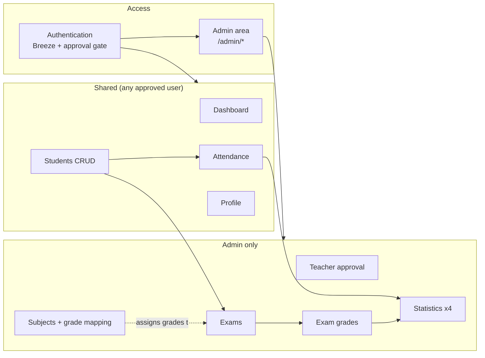

# System Overview

## What StudentHub is

StudentHub is a **school management system** for a single school. It centralizes the day-to-day academic operations that would otherwise live in paper registers or spreadsheets:

- a registry of students grouped by grade (1–12) and class section (A–Z),
- daily attendance marking per student,
- a catalogue of subjects assignable to grade levels,
- exams targeted at a specific subject + grade + section, with per-student marks,
- statistical dashboards at subject, class, grade, and whole-school level,
- and a teacher onboarding workflow gated by admin approval.

## Who uses it

| Role | Who | What they do |
|---|---|---|
| **Admin** | School administrator | Everything teachers can do, **plus**: approve/reject teacher accounts, manage subjects and their grade assignments, create/manage exams, enter exam grades, and view all statistics dashboards |
| **Teacher** | Teaching staff | View the dashboard, manage student records (CRUD), mark and review attendance. **Cannot** access anything under `/admin/*` |
| **Guest** | Unauthenticated visitors | Landing page, registration, login, password reset |

There is no student or parent-facing role, and no self-service way to become an admin — admin accounts are created only via `AdminSeeder` or direct database insertion.

## The approval gate — the defining business rule

StudentHub has **two independent gates** before a user can do anything:

1. **Authentication** (`auth` middleware + `LoginRequest`) — you must have an account and valid credentials.
2. **Approval** — `LoginRequest::authenticate()` logs the user out again if `users.status !== 'approved'`. This applies to *every* role, including admins.

On top of that, the `admin` middleware (`AdminMiddleware`) additionally requires `role === 'admin'` **and** `status === 'approved'` for all `/admin/*` routes.

```
Register ──► users row: role='teacher', status='pending'
                │
                ▼
          Cannot log in (status gate)
                │
                ▼
   Admin approves at /admin/teachers ──► status='approved'
                │
                ▼
        Can log in; teacher sees students/attendance only
```

## Technology stack (verified from `composer.json` / `package.json`)

| Layer | Technology |
|---|---|
| Language | PHP **8.3+** |
| Framework | Laravel **13.x** (`laravel/framework ^13.17`) |
| Auth scaffolding | Laravel Breeze 2.x (session-based, Blade) |
| Database | **MySQL 8.0+** (official); SQLite `:memory:` for tests only |
| ORM | Eloquent |
| Frontend | Blade, Tailwind CSS v3, Alpine.js v3 |
| Build | Vite 8 + `laravel-vite-plugin` |
| Testing | PestPHP 4 + `pest-plugin-laravel` |
| Tooling | Laravel Pint, Pail, Tinker |

## High-level module map



## Key design characteristics

- **Convention over configuration** — standard Laravel MVC; no services, actions, or repositories. Business logic lives directly in controllers.
- **Validation in controllers** — most modules call `$request->validate([...])` inline; only auth/profile use Form Requests.
- **Database-level integrity** — uniqueness and foreign keys are enforced by migrations (`unique` constraints, `foreignId()->constrained()`), not just validation.
- **Read-heavy statistics** — all four statistics endpoints and the dashboard wrap queries in `Cache::remember` (60–300 s TTL) with **no invalidation hooks**.
- **No API** — there is no `routes/api.php`; the application is server-rendered Blade only.
