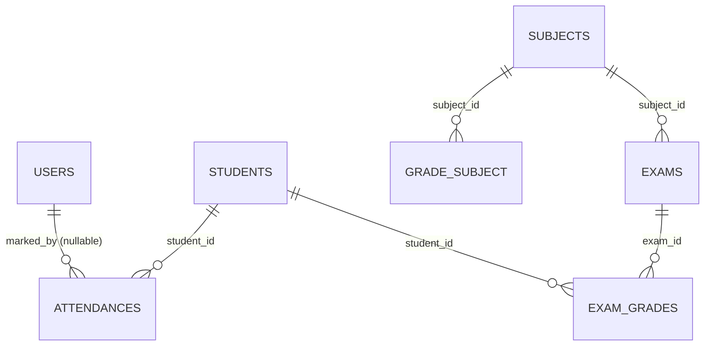

# Database Overview

## Engine support

| Engine | Status |
|---|---|
| **MySQL 8.0+** | **Officially supported.** `.env.example` sets `DB_CONNECTION=mysql`; this is the tested development configuration |
| SQLite | Used **only** by the automated test suite via `phpunit.xml` (`DB_CONNECTION=sqlite`, `DB_DATABASE=:memory:`). Not a supported development database |

The MySQL connection uses `utf8mb4` / `utf8mb4_unicode_ci`, `strict` mode, and persistent connections disabled (`config/database.php`).

### Compatibility notes

- `attendances.status` is a MySQL `enum('present','absent')`. SQLite has no native enum — Laravel emulates it as a `varchar` with a `check` constraint in newer versions, which is why tests can run at all.
- `students.grade` is `unsignedTinyInteger` while `grade_subject.grade`, `exams.grade` are `string`. Joins between them rely on MySQL's implicit numeric↔string coercion — see [database-design-decisions.md](database-design-decisions.md).
- `whereRaw("CONCAT(first_name, ' ', last_name) LIKE ?")` in `StudentController` is standard SQL and works on both engines.
- Statistics use `selectRaw('SUM(...)')`, `whereDate()`, and `groupBy` — all portable.

## Table inventory

### Application tables (7)

| Table | Purpose | Key constraints |
|---|---|---|
| `users` | Teacher/admin accounts with role + approval status | `email` unique |
| `students` | Student registry | `student_code` unique, `email` unique (nullable) |
| `attendances` | One present/absent record per student per day | `unique(student_id, date)` |
| `subjects` | Subject catalogue | `name` unique |
| `grade_subject` | Which subjects are taught in which grades | `unique(subject_id, grade)` |
| `exams` | Exam definitions targeting subject+grade+section | indexes on `(grade, class_section)` and `exam_date` |
| `exam_grades` | Marks per student per exam | `unique(exam_id, student_id)` |

### Laravel framework tables (8)

| Table | Created by | Used for |
|---|---|---|
| `migrations` | framework | Migration tracking |
| `password_reset_tokens` | `0001_01_01_000000` | Password reset flow |
| `sessions` | `0001_01_01_000000` | `SESSION_DRIVER=database` |
| `cache` | `0001_01_01_000001` | `CACHE_STORE=database` |
| `cache_locks` | `0001_01_01_000001` | Cache locks |
| `jobs` | `0001_01_01_000002` | `QUEUE_CONNECTION=database` (unused) |
| `job_batches` | `0001_01_01_000002` | Batch jobs (unused) |
| `failed_jobs` | `0001_01_01_000002` | Failed jobs (unused) |

## Entity relationships at a glance

There is deliberately **no `classes`/`sections` table** — a "class" is the pair `(students.grade, students.class_section)`, and exams/attendance reference that pair by value, not by foreign key. See [database-design-decisions.md](database-design-decisions.md) for the trade-offs.

## Migration history (application migrations only)

| Migration | Effect |
|---|---|
| `2026_11_03_182612_create_students_table` | Creates `students` — **already includes `notes`** |
| `2026_11_09_132450_create_attendances_table` | Creates `attendances` with unique `(student_id, date)` |
| `2026_11_09_193355_create_subjects_table` | Creates `subjects` |
| `2026_11_09_193416_create_grade_subjects_table` | Creates `grade_subject` pivot |
| `2026_11_09_195725_create_exams_table` | Creates `exams` |
| `2026_11_09_214149_create_exam_grades_table` | Creates `exam_grades` |
| `2026_11_12_164107_fix_missing_columns_in_exams_table` | Defensive `hasColumn`/`hasIndex` guards — no-ops on a clean install |
| `2026_11_16_223616_add_notes_to_students_table` | Adds `students.notes` — **duplicate; breaks fresh installs** |
| `2026_11_17_000000_add_performance_indexes` | Adds indexes on `students(grade, class_section, status)` and `attendances(date, status)` |

> ⚠️ The duplicate `notes` migration is a **verified bug**: `php artisan migrate` on an empty database fails with `duplicate column name: notes`, which also breaks `php artisan test`. See [project-status.md](../project-status.md).
