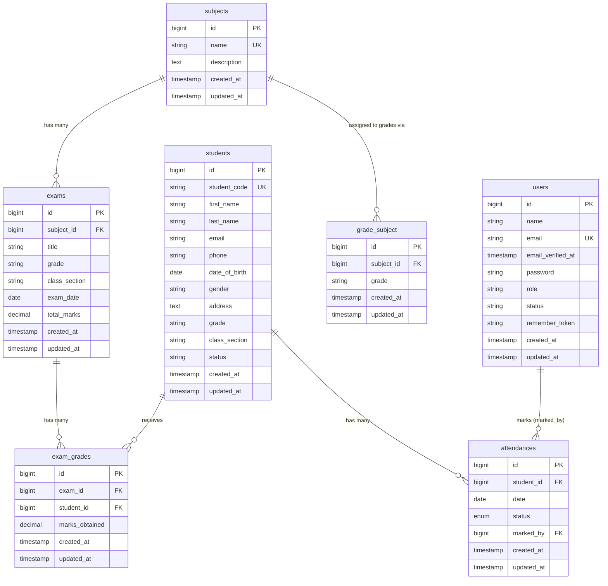

# Entity Relationship Diagram

The following diagram represents all application-defined tables and their relationships. Laravel system tables (`cache`, `jobs`, `sessions`, `password_reset_tokens`) are omitted for clarity.

---

## Mermaid ER Diagram

---

## Relationship Descriptions

### `students` → `attendances` (One-to-Many)

Each student can have many attendance records (one per day). The unique constraint `(student_id, date)` ensures only one attendance record exists per student per day.

### `users` → `attendances` (One-to-Many, optional)

The `marked_by` column records which authenticated user marked the attendance. This is nullable — if the user account is deleted, the `marked_by` value is set to `NULL` (nullOnDelete constraint). The marking user does not need to be an admin; any authenticated user (teacher) can mark attendance.

### `subjects` → `grade_subject` (One-to-Many)

A subject can be assigned to multiple grade levels. Each `grade_subject` row represents the assignment of one subject to one grade string. This is maintained as a full model rather than a simple pivot, allowing for future extension.

### `subjects` → `exams` (One-to-Many)

Each exam belongs to exactly one subject. Deleting a subject cascades to delete all its exams (and by extension, all exam grade records for those exams).

### `exams` → `exam_grades` (One-to-Many)

Each exam can have many grade records, one per student. The unique constraint `(exam_id, student_id)` prevents duplicate grading.

### `students` → `exam_grades` (One-to-Many)

Each student can receive many exam grade records across different exams.

---

## Cross-Table Logic (Not Enforced by Foreign Keys)

The following relationships are enforced at the **application layer**, not by database foreign keys:

| Constraint | Where enforced |
|---|---|
| An exam's `grade`+`class_section` must match real students | `ExamController::validateExam()` — `Rule::exists('students', ...)` |
| An exam's `grade` must be assigned to its subject via `grade_subject` | `ExamController::validateExam()` — `Rule::exists('grade_subject', ...)` |
| Exam grades can only be entered for students in the exam's grade+section | `ExamGradeController::store()` — queries students by grade+section |

There is no foreign key between `exams.grade` / `exams.class_section` and the `students` table. The referential integrity here is entirely application-enforced.
