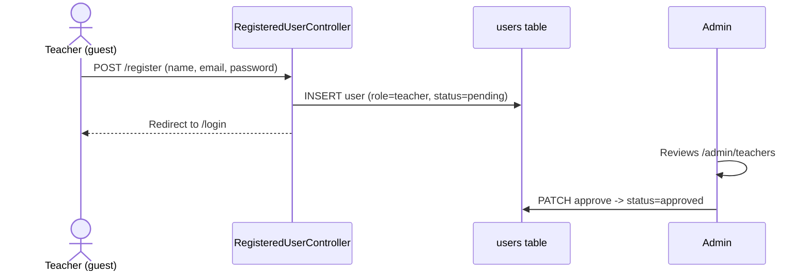
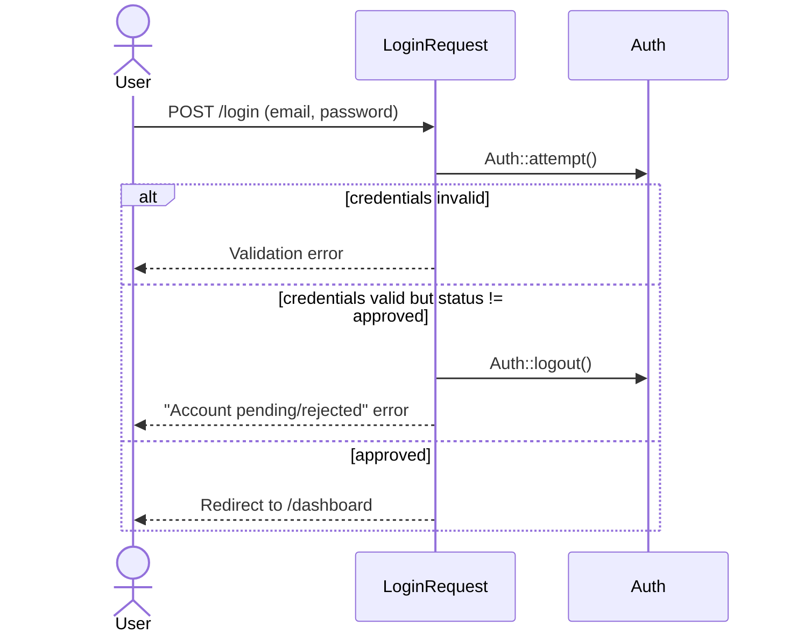

# Workflow: Authentication & Approval

## Overview

StudentHub uses session-based authentication via Laravel Breeze. Every self-registered account is created as a **teacher with `pending` status** and cannot log in until an admin approves it. The only admin account is created by `AdminSeeder`.

---

## Registration Flow

1. `GET /register` renders the Breeze registration form.
2. `POST /register` validates name/email/password and creates the user with hardcoded `role = 'teacher'` and `status = 'pending'` (`RegisteredUserController@store`). There is no role selection at registration.
3. The user is redirected to `/login` with a notice that the account awaits approval.

## Login Flow (with approval gate)

`LoginRequest::authenticate()` performs `Auth::attempt()`, then explicitly checks `$user->status !== 'approved'`. Pending or rejected users are logged out immediately and receive a validation error — the approval gate is enforced **at login**, not by middleware on every request.

## Logout

`POST /logout` → `AuthenticatedSessionController@destroy` invalidates the session and redirects to `/`.

## Password Reset

Standard Breeze flow (`/forgot-password` → email link → `/reset-password/{token}`). With `MAIL_MAILER=log` in development, reset links are written to `storage/logs/laravel.log`.

## Email Verification

Routes exist (`/verify-email`, signed verification links) but are **not enforced**: the `MustVerifyEmail` interface on `User` is commented out, so unverified users can log in normally.

## Profile Management

Authenticated users can update their name/email (`PATCH /profile`), change their password (`PUT /password`), and delete their account (`DELETE /profile`).

---

## Authorization Summary

| Capability | Teacher (approved) | Admin (approved) |
|---|---|---|
| Dashboard, profile, students CRUD, attendance | Yes | Yes |
| Subjects, exams, exam grades, statistics, teacher approvals | No (403 via `AdminMiddleware`) | Yes |
| Register new teacher accounts | Yes (self-service, becomes pending) | Yes |

See also: [authentication.md](../modules/authentication.md), [teacher-management.md](../modules/teacher-management.md).