# Workflow: Teacher Approval

## Overview

Self-registered users always become `role=teacher`, `status=pending`. An admin reviews pending accounts at `/admin/teachers` and approves or rejects them. There is no way to register as admin through the UI.

---

## Flow

```mermaid
flowchart TD
    A[Teacher registers] --> B[User created: role=teacher, status=pending]
    B --> C[Teacher tries to log in]
    C --> D{status == approved?}
    D -->|No| E[Logged out with pending/rejected message]
    D -->|Yes| F[Access granted]
    B --> G[Admin opens /admin/teachers]
    G --> H[Only pending teachers listed]
    H --> I{Admin action}
    I -->|Approve| J[status=approved -> can log in]
    I -->|Reject| K[status=rejected -> login blocked]
```

## Implementation Details

- **List:** `TeacherApprovalController@index` queries `User::where('role','teacher')->where('status','pending')` — approved and rejected teachers disappear from the list.
- **Approve:** `PATCH /admin/teachers/{user}/approve` sets `status = 'approved'`.
- **Reject:** `PATCH /admin/teachers/{user}/reject` sets `status = 'rejected'`.
- **Generic update:** `PATCH /admin/teachers/{user}/{status}` → `TeacherApprovalController@update` is the route the Blade view actually submits to.
- **Authorization:** all routes require `auth` + `admin` middleware.

## Post-Decision Behaviour

- **Approved** teachers can log in normally on their next attempt.
- **Rejected** teachers remain in the `users` table but can never log in (`LoginRequest` blocks any non-`approved` status).
- Neither decision sends an email — the teacher discovers the outcome only by attempting to log in.
- There is no UI to view previously approved/rejected teachers or to undo a decision; changes require direct database access.

See also: [teacher-management.md](../modules/teacher-management.md), [authentication-flow.md](authentication-flow.md).